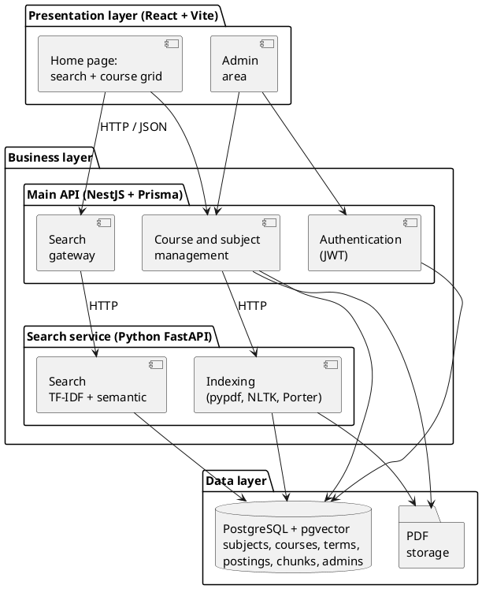
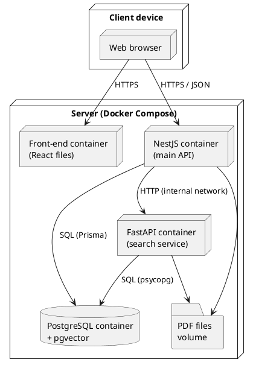
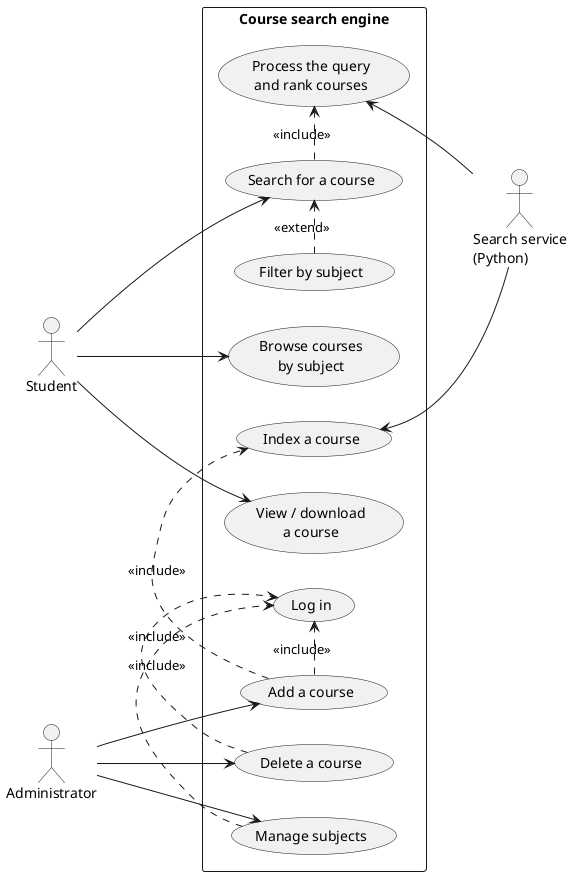
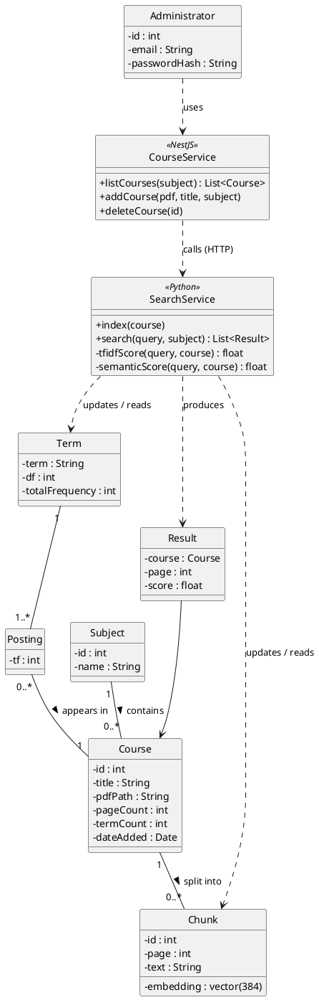
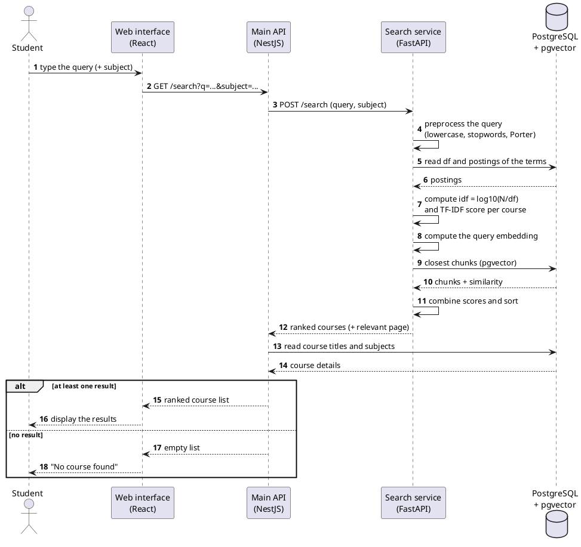
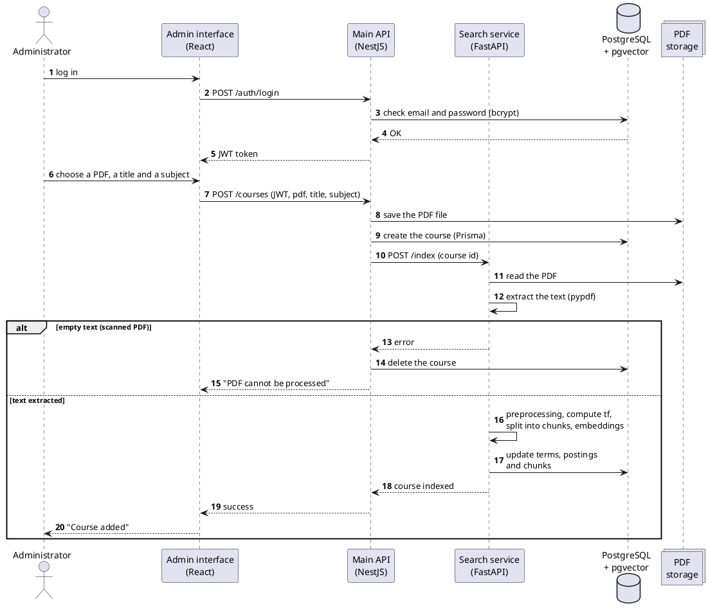
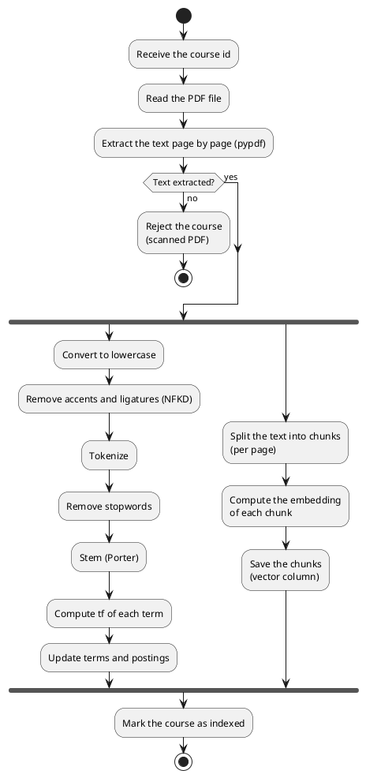

<!-- Markdown version of the requirements specification, for tools like Claude Code. Diagrams are included as PlantUML source. -->

**SESAME University**

Bachelor in Computer Science & Multimedia (LIM 3) — Academic year 2025-2026

**REQUIREMENTS SPECIFICATION**

Course search engine for students

*Module: Indexing and Referencing Techniques*

**Instructor:** Dr. Fatma HMISSI

**Prepared by:** Safi Hanafi, Makrem Riahi, Mohamed Aziz Mrabet

**Project repository:** github.com/Mohamedazizmrabet/search-engine

# 1. Context

Throughout their studies, SESAME University students take several subjects, each with course materials in PDF format: chapters, tutorials and summaries. These documents are published on the university’s learning platform (Konosys LMS) and keep piling up as the semester goes on.

When students revise or prepare for an exam, they often look for a specific concept (for example “API”, “TF-IDF” or “Docker”) without knowing which chapter, or sometimes even which subject, covers it.

This project is part of the “Indexing and Referencing Techniques” module. It applies the automatic indexing techniques studied in class, complemented by modern semantic search, to build a search engine dedicated to students’ course materials.

# 2. Problem statement

## 2.1 Existing solution: the SESAME LMS

SESAME courses are available on the Konosys LMS platform (lms.konosys.com/sesame). The “My courses” page offers a search bar, but it only searches the names of subjects, departments and classes. It does not read the content of the courses.

> *Screenshot (not included in this Markdown version): the Konosys LMS “My courses” page shows a search bar (“Search for a course, a department, a class…”), sort and academic-year filters, and a grid of course cards. Each card shows the teaching unit (UE) and the course title, e.g. “UE: SOA and indexing — SOA Architecture and Web Services LIM3-C-S1”, “UE: Cloud & Big Data — Virtualization and Cloud LIM3-C-S1”.*

*Figure 1 — “My courses” page of the SESAME LMS platform*

**Example:** a student who types “API” into this search bar gets no results, because no subject is called “API”. Yet this concept is central to courses such as “SOA Architecture and Web Services” or “Web and Multimedia Application Development”. The information exists, but the platform cannot find it.

The following table shows the expected difference between the current search and the proposed engine:

| **Query** | **Current LMS (name search)**                    | **Proposed engine (content search)**                                |
|-----------|--------------------------------------------------|---------------------------------------------------------------------|
| API       | No results                                       | Courses that cover APIs, e.g. “SOA Architecture and Web Services”   |
| TF-IDF    | No results                                       | Chapters of “Indexing and Referencing Techniques”                   |
| Docker    | No results                                       | Chapters of “Virtualization and Cloud”                              |
| Hadoop    | No results                                       | Chapters of “Big Data Frameworks & Technologies”                    |
| Indexing  | “Indexing Techniques…” (the word is in the name) | The most relevant chapters, ranked by score, with the relevant page |

## 2.2 Limits of exact-word search

Even a PDF reader’s search is not enough: it only works in one file at a time, and only on the exact word typed. The same word can appear in several forms (index, indexing, indexed), very frequent words (the, is, of) carry no information, not all terms in a course are equally important, and two different wordings can express the same idea (“API” and “web service”).

The central question of the project is therefore: ***how can a student quickly find, among all the courses of every subject, the documents most relevant to the concept they are looking for, even when that concept does not appear in the subject’s name?***

# 3. Objectives

## 3.1 General objective

Design and build a web application that lets students search, by keyword, for the most relevant courses in a collection of PDF course materials, by searching their content and not just the subject names, while still being able to browse the courses directly.

## 3.2 Specific objectives

- Automatically extract the text of PDF courses (in English).

<!-- -->

- Apply the classic automatic indexing pipeline from the course: lexical analysis, stopword removal, Porter stemming, TF-IDF weighting and inverted file.

<!-- -->

- Complement keyword search with semantic search based on vectors (embeddings), able to find passages that express the same idea in other words.

<!-- -->

- Return a list of courses ranked by relevance, showing the most relevant page, with a subject filter.

<!-- -->

- Let students browse all courses as a grid organized by subject, as on the LMS platform.

<!-- -->

- Provide an admin interface to manage courses and subjects.

# 4. Actors

| **Actor**      | **Type**  | **Role**                                                                                                                               |
|----------------|-----------|----------------------------------------------------------------------------------------------------------------------------------------|
| Student        | Primary   | Searches for courses by keyword, browses courses by subject, views and downloads courses. No account is required.                      |
| Administrator  | Primary   | Team member or instructor in charge of the content. Logs in, adds and deletes courses, and manages the list of subjects.               |
| Search service | Secondary | Automatic component (Python) that extracts text from PDFs, builds and updates the index and vectors, and ranks courses for each query. |

Only courses provided by the administrator are indexed: students cannot upload their own documents. This guarantees the quality and consistency of the content.

# 5. Functional requirements

## 5.1 Student

| **Ref.** | **Requirement**     | **Description**                                                                                                                      |
|----------|---------------------|--------------------------------------------------------------------------------------------------------------------------------------|
| FR1      | Search for a course | Main feature: type an English query in the search bar, always visible at the top of the page, and search the content of the courses. |
| FR2      | Filter by subject   | Limit the search to the courses of a subject chosen from a list.                                                                     |
| FR3      | Browse courses      | See all courses as cards organized by subject, and open a course directly without searching.                                         |
| FR4      | View results        | Display courses ranked by decreasing relevance, with their title, subject and most relevant page.                                    |
| FR5      | Open a course       | Open a course PDF in the browser (at the relevant page when possible) or download it.                                                |
| FR6      | No results          | Display a clear message when no course matches the query.                                                                            |

## 5.2 Administrator

| **Ref.** | **Requirement** | **Description**                                                                           |
|----------|-----------------|-------------------------------------------------------------------------------------------|
| FR7      | Log in          | Access the admin area with an email and password.                                         |
| FR8      | Add a course    | Upload a PDF file and give it a title and a subject; the course is indexed automatically. |
| FR9      | Delete a course | Remove a course; its file, terms and vectors are removed from the index.                  |
| FR10     | Manage subjects | Add, rename or delete a subject.                                                          |

## 5.3 Search service

| **Ref.** | **Requirement**  | **Description**                                                                     |
|----------|------------------|-------------------------------------------------------------------------------------|
| FR11     | Extract text     | Read the PDF page by page; reject scanned PDFs with no text.                        |
| FR12     | Lexical analysis | Lowercasing, removing accents and ligatures, tokenization.                          |
| FR13     | Stopwords        | Remove English stopwords and one-letter terms.                                      |
| FR14     | Stemming         | Reduce each term to its stem (Porter algorithm).                                    |
| FR15     | Inverted file    | Compute tf and df and update the dictionary and postings.                           |
| FR16     | Semantic vectors | Split each course into chunks (per page) and compute a vector (embedding) for each. |
| FR17     | Hybrid ranking   | Combine the TF-IDF score and semantic similarity to rank courses.                   |

# 6. Non-functional requirements

| **Criterion**   | **Requirement**                                                                                                                                                                                             |
|-----------------|-------------------------------------------------------------------------------------------------------------------------------------------------------------------------------------------------------------|
| Availability    | Once deployed, the application must be available 24/7, with a target uptime of at least 99% (less than 7 hours of downtime per month), especially during exam periods.                                      |
| Performance     | A search must return results in under 2 seconds. Indexing a new course must take less than two minutes.                                                                                                     |
| Scalability     | The system must handle several dozen simultaneous students without noticeable slowdown.                                                                                                                     |
| Security        | Encrypted communication (HTTPS); hashed passwords (bcrypt); admin access protected by JWT; search service only reachable by the main API; secrets stored in .env files excluded from the GitHub repository. |
| Reliability     | Regular backups of the database and PDFs; an invalid PDF must not stop the indexing of other courses; the index must be rebuildable from the PDFs.                                                          |
| Usability       | Interface inspired by the LMS course grid students already know: main search bar at the top, courses shown as cards by subject. Usable without training.                                                    |
| Compatibility   | Responsive interface (computer, tablet, smartphone), compatible with recent browsers (Chrome, Firefox, Edge, Safari).                                                                                       |
| Portability     | Every component is containerized with Docker: the application runs the same way on each team member’s machine and on the server.                                                                            |
| Maintainability | Modular architecture (front-end, main API, search service) with automated tests (pytest, Jest), so one component can change without affecting the others.                                                   |
| Extensibility   | Adding a new course must not require re-indexing the whole collection.                                                                                                                                      |

# 7. Technologies

| **Area**            | **Technology**          | **Rationale**                                                                                        |
|---------------------|-------------------------|------------------------------------------------------------------------------------------------------|
| Front-end           | React + Vite            | Fast, responsive web interface; Vite gives instant startup and reload.                               |
| Styling             | Tailwind CSS            | Quick to build the card grid and a responsive interface.                                             |
| Main API            | NestJS (TypeScript)     | Structured framework (modules, controllers, services) for authentication, courses and subjects.      |
| ORM                 | Prisma                  | Typed database access, single schema and versioned migrations shared by the team.                    |
| Authentication      | JWT + bcrypt            | Signed session tokens and hashed passwords.                                                          |
| Search service      | Python + FastAPI        | Directly reuses the indexing pipeline already written in Python.                                     |
| PDF extraction      | pypdf                   | Page-by-page text extraction.                                                                        |
| Language processing | NLTK                    | English stopwords and the Porter algorithm seen in class.                                            |
| Embeddings          | sentence-transformers   | Free model running locally to turn text into a vector.                                               |
| Database            | PostgreSQL              | Robust relational database; the inverted file (dictionary and postings) maps directly to tables.     |
| Vector search       | pgvector                | PostgreSQL extension: vectors and similarity search in the same database, with no cloud-tier limits. |
| Python driver       | psycopg                 | PostgreSQL access from the search service.                                                           |
| Containers          | Docker / Docker Compose | Start every component with one command, identical for the whole team.                                |
| Tests               | pytest, Jest            | Tests for the Python service (including TF-IDF calculations) and the NestJS API.                     |
| Version control     | Git / GitHub            | Collaboration among three members with branches and pull requests.                                   |
| Design              | PlantUML                | UML diagrams.                                                                                        |

**Why two back-end services?** text processing (extraction, NLTK, embeddings) is simpler and richer in Python, while NestJS offers a clear structure for the application side (accounts, courses, files). Each service does what its language does best, and they communicate over HTTP.

# 8. Logical and physical architecture

## 8.1 Logical architecture

The application follows a three-layer architecture whose business layer is split into two services. The presentation layer (React) displays the home page (search and course grid) and the admin area. The business layer contains the main API (NestJS), which handles authentication, courses and subjects and acts as a gateway to the search service (Python), responsible for indexing and ranking. The data layer combines PostgreSQL with pgvector and the PDF file storage.

*Figure 2 — Logical architecture*

The front-end never talks to the search service directly: every request goes through the main API. The search service applies exactly the same processing to the query as to the courses, which makes its terms and vector comparable to those in the index.

## 8.2 Physical architecture

All components are deployed as Docker containers, orchestrated by Docker Compose on a single server: front-end, NestJS API, FastAPI service and PostgreSQL. PDF files are stored in a shared volume. The student’s browser communicates over HTTPS with the front-end and the main API; the search service and the database are only reachable from the containers’ internal network. Each team member uses the same setup locally.

*Figure 3 — Physical architecture (deployment)*

# 9. Design

## 9.1 Use case diagram

*Figure 4 — Overall use case diagram*

**Description of the main use case:**

<table>
<colgroup>
<col style="width: 26%" />
<col style="width: 73%" />
</colgroup>
<tbody>
<tr class="odd">
<td><strong>Use case</strong></td>
<td>Search for a course</td>
</tr>
<tr class="even">
<td><strong>Actor</strong></td>
<td>Student</td>
</tr>
<tr class="odd">
<td><strong>Precondition</strong></td>
<td>At least one course is indexed.</td>
</tr>
<tr class="even">
<td><strong>Main scenario</strong></td>
<td>
1. The student types a query (for example “API”) and optionally chooses a subject.

2. The main API forwards the query to the search service.

3. The service processes the query (lexical analysis, stopwords, stemming) and computes its vector.

4. For each course, the service computes a TF-IDF score and a semantic similarity, combines them and sorts the courses.

5. The system displays the ranked courses, with the most relevant page.
</td>
</tr>
<tr class="odd">
<td><strong>Alternative scenario</strong></td>
<td>4a. No relevant course: the system displays “No course found”.</td>
</tr>
<tr class="even">
<td><strong>Postcondition</strong></td>
<td>The student can open the course at the suggested page or download it.</td>
</tr>
</tbody>
</table>

## 9.2 Class diagram

*Figure 5 — Class diagram*

## 9.3 Sequence diagram: search for a course

*Figure 6 — “Search for a course” sequence*

**Ranking combines two scores, each normalized between 0 and 1:**

- **TF-IDF score (course method):** sum of the weights of the terms shared with the query: score_tfidf(q, d) = Σ tf(t, d) × idf(t), with idf(t) = log10(N / df(t)), where N is the number of courses.

<!-- -->

- **Semantic score:** cosine similarity between the query vector and the closest chunk of the course, computed by pgvector.

<!-- -->

- **Final score:** score(q, d) = α × score_tfidf + (1 − α) × semantic_score, with α = 0.5 by default, tuned during testing.

## 9.4 Sequence diagram: add a course

*Figure 7 — “Add a course” sequence*

## 9.5 Activity diagram: indexing a course

*Figure 8 — “Indexing a course” activity*

Both branches run on the same extracted text: the left branch builds the inverted file (classic method), the right branch produces the vectors for semantic search.

## 9.6 Data model (PostgreSQL)

| **Table** | **Content**              | **Main fields**                                                     |
|-----------|--------------------------|---------------------------------------------------------------------|
| subjects  | One row per subject      | id, name                                                            |
| courses   | One row per PDF course   | id, title, subject_id, pdf_path, page_count, term_count, created_at |
| terms     | Inverted file dictionary | term, df, total_frequency                                           |
| postings  | Inverted file postings   | term, course_id, tf                                                 |
| chunks    | Chunks and their vectors | id, course_id, page, text, embedding vector(384)                    |
| admins    | Administrator accounts   | id, email, password_hash                                            |

**Design choices:**

- **Inverted file as tables:** the terms and postings tables directly reproduce the dictionary / postings structure of the inverted file studied in class.

<!-- -->

- **idf computed at search time:** idf depends on the total number of courses N, which changes with every addition. Only tf and df are stored; idf and the TF-IDF score are computed at search time, which avoids recomputing the whole index for each new course.

<!-- -->

- **Prisma as the single source of the schema:** the database schema is defined and migrated only by Prisma; the Python service reads and writes these tables without changing their structure.

<!-- -->

- **PDFs outside the database:** PDF files are stored in a volume and the database only keeps their path, which keeps the database lightweight.

## 9.7 User interface

The home page follows the layout of the LMS platform: a main search bar at the top, a subject filter, then the course grid as cards showing the subject (UE) and course title. Students can open a course directly from the grid or run a search. The results page shows the ranked courses, with their subject and most relevant page. The admin area, available after logging in, lets administrators add or delete courses and manage subjects.
